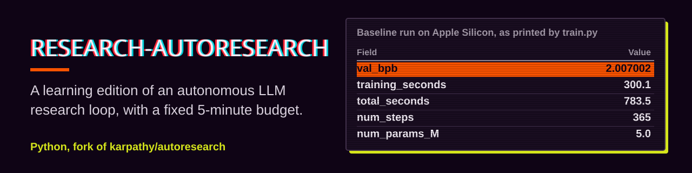

<p align="center">
  <picture><source media="(prefers-color-scheme: dark)" srcset="assets/banner-dark.svg"></picture>
</p>

# autoresearch

**English** · [繁體中文](README.zh-TW.md)

This README is best read as a learning guide.

If this is your first time in this repo, don't think of it as a research system you need to get running straight away. It is more useful as a small case study: how an LLM experiment project can be kept small, clear and easy to compare. The repo has also been adapted to run the learning-edition experiments on Apple Silicon, so it is no longer limited to NVIDIA CUDA.

## Timeline

- 2026-03: the project appears as a minimal automated research playground. The core idea is to make `train.py` the main experiment surface and let an agent repeatedly propose, run, compare and keep experiments within a fixed 5-minute budget.
- 2026-04-09: the README and `program.md` are rewritten as a learning guide and a research protocol. The focus moves from a project manifesto to "what you can learn from this repo" and "how the experiment workflow is made systematic".
- 2026-04-10: the project becomes a learning edition that runs on Apple Silicon. Dependencies are no longer tied to a CUDA-only `torch`; `train.py` and `prepare.py` gain `cuda` / `mps` / `cpu` device detection and fallback paths, and the Apple Silicon defaults for model size, batch and numerical stability are made more conservative.
- 2026-04-10: the same day, a guide to reading `train.py`'s output is added, so that someone seeing fields like `val_bpb`, `training_seconds`, `total_seconds` and `peak_vram_mb` for the first time can read the log as learning material.
- 2026-07-20: support for Windows + consumer NVIDIA GPUs (tested on an RTX 4060 8GB): real sliding-window attention through FlexAttention (FA3 supports only Hopper), VRAM-tiered defaults, a `GQA_RATIO` hyperparameter and torch 2.6 compatibility fixes. The platform infrastructure is also moved out into `runtime.py`, so `train.py` goes back to being purely the experiment surface.

## Who this project is for

This repo suits readers who:

- want to see what a small LLM training loop looks like
- want to understand how a research project is split into fixed and variable conditions
- want to learn how to turn "running experiments" into a repeatable process
- want to understand how an AI agent can be put into a research workflow

If you are new to model training, the value of this repo is not in having many features but in how tightly it concentrates the important ideas.

## What you will learn here

The repo mainly teaches four things:

1. **How to shrink a research project**
   Not all research needs a large framework. Often, shrinking the problem to a minimal system you can verify quickly and repeatedly is the easier way to learn.

2. **What to hold fixed and what to change**
   If data processing, evaluation and the time budget keep drifting, you can hardly tell whether a model improved because the idea was good or because the conditions quietly changed. This repo deliberately gathers the fixed conditions in one place and squeezes the real research variables into a few spots.

3. **Experiments are a system of comparison, not one-off inspiration**
   The most important thing here is not any particular modelling trick, but how you set a baseline, record results and decide whether a change stays or goes.

4. **An agent can take part in research, provided the rules are clear**
   The repo contains not only training code but also `program.md`, a "research protocol". It is a reminder that letting an agent do research is not just letting it edit code; you first define how it works.

## The big picture first

The core idea of `autoresearch` is simple: make the research loop as short as possible.

One round of experimentation looks roughly like this:

1. Edit `train.py`
2. Run a fixed 5-minute training
3. Read `val_bpb`
4. Decide whether to keep or discard the change

The benefit is that the research questions become concrete:

- In the same amount of time, which design learns more efficiently?
- Is a change really better, or does it just use more resources?
- Is a new idea worth keeping, or does it only add complexity?

This differs from the usual "keep tuning until it looks better". It is closer to learning how to set up clean rules for comparison.

## Suggested reading order

If this is your first time in the repo, read in this order:

1. This `README.md` first
   The aim is to understand what the repo is trying to teach before looking at details.

2. Then `prepare.py`
   This file shows what is treated as the fixed experiment environment. Data, tokenizer, evaluation and constants are mostly here.

3. Then `train.py`
   This is the most important experiment surface. Model architecture, optimizer, hyperparameters, batch settings and the training loop are nearly all here.

4. Finally `program.md`
   It is not model code but the agent's working instructions. After reading it you will see more clearly how the project formalises the research workflow into executable rules.

Reading in this order makes it easier to tell apart:

- what is infrastructure
- what is a research variable
- what is the research workflow

## The three files most worth studying

### `prepare.py`

Think of this file as the "fixed experiment environment". It roughly handles:

- downloading data
- training the tokenizer
- the dataloader
- evaluation
- constants that should not change from one experiment to the next

While reading it, ask yourself: why are these things in the fixed area rather than left for the agent to modify too?

### `train.py`

This is the main research surface. It contains:

- the model architecture
- the optimizer
- hyperparameters
- batch settings
- the training loop

Think of it as the repo's "lab bench". Most of the ideas genuinely worth comparing happen here.

### `program.md`

This file is a good way to learn how a research workflow is written down. Its focus is not the model but:

- how to establish a baseline
- how to record experiment results
- when to keep
- when to discard
- how the agent should keep working

If you usually treat a README as just a project description, pay special attention to this file: it is more like a research operations manual.

## The most important design ideas in this repo

### 1. A fixed time budget

Every training run lasts only **5 minutes of wall-clock time**.

This is worth learning from, because it turns the question from "who trained longest" into "who learned most efficiently in the same time".

### 2. A fixed evaluation metric

The main metric is **`val_bpb`**, and lower is better.

That gives every round of experiments a consistent basis for comparison. It matters for learners too, because it makes it easier to see what a change actually did.

### 3. A small variable surface

The repo has little in the way of distributed training settings, a huge config system or thick abstraction layers. Not because those have no value, but because once a system gets too big, learners find it harder to see what actually drives the experiment.

### 4. Research includes discarding

Many people learning to build models focus on producing new changes and pay less attention to judging when a change is not worth keeping. What makes this repo especially educational is that keep / discard is also part of the process.

## Getting the project running

If you want to get the project working first, treat this section as setting up a learning environment.

**Requirements**: Python 3.10, [uv](https://docs.astral.sh/uv/), and one of the following devices:

- NVIDIA GPU: fastest, and closest to the original design target
- Apple Silicon (MPS): fine for learning and small-scale experiments
- CPU: usable for reading along and checking that things work, but slowest

The repo now picks `cuda`, `mps` or `cpu` automatically based on the device. On NVIDIA GPUs it prefers the original CUDA-optimised path; on Apple Silicon it automatically falls back to PyTorch's built-in attention and more conservative optimizer / precision settings.
Apple Silicon and CPU also automatically use a smaller default model and batch. The goal is to get the whole experiment loop running first, not to chase the original H100 configuration.

The repo pins `Python 3.10` in [`.python-version`](.python-version). If you have `pyenv` or a compatible tool installed, it usually switches to this version automatically when you enter the project; if you don't have `pyenv`, skip the two lines below and use your existing Python 3.10 environment.

```bash
# 1. Install uv (if you don't have it yet)
curl -LsSf https://astral.sh/uv/install.sh | sh

# 2. Switch to Python 3.10 (only needed with pyenv)
pyenv install 3.10 -s
pyenv local 3.10

# 3. Install dependencies
uv sync

# 4. Prepare data and tokenizer (one-off, about 2 minutes)
uv run prepare.py

# 5. Run one baseline training (about 5 minutes)
uv run train.py
```

If all five steps succeed, your environment is enough to read `train.py`'s output and understand how the whole experiment loop works.

If you see `zsh: command not found: pyenv`, your machine doesn't have `pyenv` installed. That is not an error in itself; it only means you can't switch versions with `pyenv`. As long as you already have a working Python 3.10, start straight from `uv sync`.

On Windows + NVIDIA you can also skip `uv` and use the system Python (3.10+) with pip:

```powershell
pip install torch --index-url https://download.pytorch.org/whl/cu126
pip install rustbpe tiktoken pyarrow requests pandas matplotlib "triton-windows<3.3"
python prepare.py
python train.py
```

`triton-windows` is what makes `torch.compile` work on Windows (the `triton` on PyPI has no Windows wheel). On startup, `runtime.py` automatically points `CUDA_PATH` at the CUDA toolchain bundled with it, so there is no need to install the CUDA Toolkit separately. torch 2.6+ has been tested and works; it does not need to match the version locked in `pyproject.toml` exactly.

If you run on Apple Silicon, speed and the room for tuning are usually not the same as on an NVIDIA GPU. Reasonable expectations are:

1. Get it running first and understand the whole experiment loop
2. Do learning experiments with a smaller model and smaller batch
3. Move to an NVIDIA GPU if you want the original repo's throughput

## Reading `train.py`'s output

The first time you see the output of `uv run train.py`, it is easy to look only at the last `val_bpb` line. In fact the log has three layers of information:

1. **What model this run used**
2. **Whether training was stable and fast**
3. **Whether the result is worth comparing**

Here is an example of a successful run on Apple Silicon:

```text
Vocab size: 8,192
Model config: {'sequence_len': 2048, 'vocab_size': 8192, 'n_layer': 4, 'n_head': 2, 'n_kv_head': 2, 'n_embd': 128, 'window_pattern': 'L'}
Parameter counts:
  wte                     : 1,048,576
  value_embeds            : 2,097,152
  lm_head                 : 1,048,576
  transformer_matrices    : 786,560
  scalars                 : 8
  total                   : 4,980,872
Estimated FLOPs per token: 2.359373e+07
Scaling AdamW LRs by 1/sqrt(128/768) = 1.000000
Time budget: 300s
Gradient accumulation steps: 2
step 00364 (99.7%) | loss: 5.632492 | lrm: 0.01 | dt: 1085ms | tok/sec: 15,094 | mfu: 0.0% | epoch: 1 | remaining: 0s
---
val_bpb:          2.007002
training_seconds: 300.1
total_seconds:    783.5
peak_vram_mb:     66.0
mfu_percent:      0.00
total_tokens_M:   6.0
num_steps:        365
num_params_M:     5.0
depth:            4
```

This output can be read as follows:

- `Vocab size: 8,192`
  The tokenizer has 8192 tokens. This is the discretisation the experiment is built on, and it affects the size of the embedding and output layers.

- `Model config: ...`
  The model configuration this run actually built. From it you can read directly: sequence length `2048`, `4` layers in total, embedding dimension `128`, attention pattern `L`. If you are tuning `DEPTH`, `HEAD_DIM` or `WINDOW_PATTERN`, this line is the first thing to check.

- `Parameter counts: ... total : 4,980,872`
  The model has about `5.0M` parameters. On Apple Silicon this is a small, learning-oriented setting; the goal is to finish the whole experiment loop reliably, not to chase large-model throughput.

- `Estimated FLOPs per token: 2.359373e+07`
  An estimate of how much computation each token needs. It is not a final score, but it helps you understand roughly how heavy this model is.

- `Scaling AdamW LRs by 1/sqrt(128/768) = 1.000000`
  The learning-rate scaling factor ended up clamped at `1.0`. On the current Apple Silicon path this is a deliberately conservative setting, to keep a small model's learning rate from being scaled up too far and causing a `FAIL` or numerical blow-up right at the start.

- `Time budget: 300s`
  Part of the fixed experiment system: the training time used for comparison is `300` seconds, i.e. 5 minutes.

- `Gradient accumulation steps: 2`
  Each optimizer update accumulates 2 micro-batches. This is usually to keep the total batch size on smaller devices while limiting per-step memory pressure.

- `step 00364 ... loss: 5.632492 ... tok/sec: 15,094`
  The live status line during training.
  `loss` is the training cross-entropy, mainly used to check that training hasn't blown up.
  `tok/sec` is throughput: roughly how many tokens are processed per second.
  In this example Apple Silicon reaches about `15k tok/sec`, a learning speed that "runs and can be observed", not a figure for chasing peak performance.

- `val_bpb: 2.007002`
  The most important final metric. `bpb` is bits per byte, and lower is better. This is the value you compare between experiments.

- `training_seconds: 300.1`
  The training time counted by the system is about 300 seconds, as designed.

- `total_seconds: 783.5`
  The whole program took about 783 seconds from start to finish. It is much larger than `training_seconds`, which means that on Apple Silicon a lot of time goes to setup, prefill, evaluation and other overhead besides training itself. That is normal on a Mac, and a reminder that `training_seconds` is the more important basis for comparison.

- `peak_vram_mb: 66.0`
  An approximate observation of peak device memory. On the current Apple Silicon path this number is small, showing that the learning-edition configuration is very conservative.

- `mfu_percent: 0.00`
  `MFU` is model FLOPs utilization. The metric is meant for CUDA/H100-type environments and is not meaningful on the Apple Silicon path yet, so `0.00` is normal.

- `total_tokens_M: 6.0`
  This 5-minute run processed about `6.0M` tokens in total.

- `num_steps: 365`
  The total number of optimizer steps. If you increase the batch or change throughput later, this number changes with it.

- `num_params_M: 5.0`, `depth: 4`
  The final summary, so you can see the model size at a glance in your records.

In one sentence: **this is a baseline learning-edition experiment that completed the full 5-minute training loop on Apple Silicon**. Its value is not in how strong `2.007002` is, but in giving you a stable, repeatable, comparable starting point. When you experiment later, use it as the baseline to compare against, rather than comparing it directly with large-model results on an H100.

## Using it as course material

These angles usually help:

- Look at how `prepare.py` and `train.py` divide the work
- Look at which settings are fixed and which are deliberately left for experiments to change
- Look at how `program.md` turns the research workflow into rules
- Look at how the repo keeps a research question from spreading into too big an engineering problem

Reading this way makes it easier to absorb it as a method, rather than treating it only as a codebase you can run.

## If you want to add an agent later

Bringing in an agent makes more sense once you understand what the repo is doing.

A typical approach is to have the agent read `program.md` first, for example:

```text
Hi have a look at program.md and let's kick off a new experiment! let's do the setup first.
```

What is most worth learning here is not the prompt itself but the design idea behind it: you are not just asking an agent to change some code, you are defining the rules for how an agent should do research.

## Project structure

```text
prepare.py      — fixed experiment environment: data, tokenizer, evaluation, constants
runtime.py      — fixed platform layer: device detection, attention backend, compile probing, VRAM tiers
train.py        — the experiment itself: model, optimizer, training loop
program.md      — research protocol: the agent's working rules
pyproject.toml  — project dependencies
```

`prepare.py` and `runtime.py` are both in the fixed area that does not change between experiments; experiments happen only in `train.py`. The point of this split is that an experiment diff only ever contains research variables, never changes to the platform plumbing.

The first time you run `uv sync` on a new machine, `uv` re-resolves and builds an environment for the current platform. When platforms differ as much as Apple Silicon and NVIDIA GPUs do, this is safer than forcing them to share one old lockfile.

## If your hardware is smaller

Although the code now runs on Apple Silicon, the original design still leans towards a single NVIDIA GPU. If you just want to use it as learning material and observe the concepts on a smaller machine, consider:

1. Switching to a lower-entropy dataset such as [TinyStories](https://huggingface.co/datasets/karpathy/tinystories-gpt4-clean)
2. Lowering `vocab_size`
3. Lowering `MAX_SEQ_LEN` in `prepare.py`
4. Reducing `EVAL_TOKENS` in `prepare.py`
5. Lowering `DEPTH` in `train.py`
6. Using a simpler `WINDOW_PATTERN`
7. Reducing `TOTAL_BATCH_SIZE`

These adjustments are not only for "making it run"; they also help you understand how model size, data distribution, sequence length and evaluation cost relate to each other.

## License

MIT
